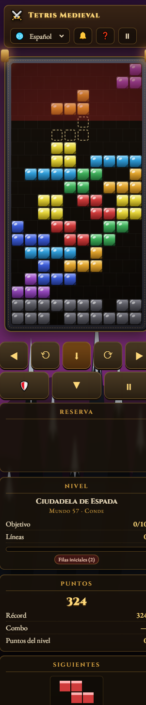

# ⚔️ Medieval Tetris — 1000 Level

**Live-Version: [https://tetris-medieval.vercel.app](https://tetris-medieval.vercel.app)**

Ein vollständiges Tetris ohne externe Abhängigkeiten mit **1000 spielbaren Leveln**, von
*sehr leicht* bis *sehr schwer*, verpackt in einer mittelalterlichen Welt: Steinmauern,
heraldische Edelsteinblöcke, Schlosskulissen, Fackellicht und Ränge von **Page** bis **Legende**.

Erstellt mit purem HTML5-Canvas + JavaScript — kein Build-Schritt, kein Framework, kein
`npm install`. Spielbar direkt aus `index.html` (sogar über `file://`) und als statische
Website auf Vercel gehostet.



<p align="center">
  <a href="https://tetris-medieval.vercel.app"><strong>▶ Jetzt spielen</strong></a> ·
  <a href="docs/LEVELS.md"><strong>Level-Design</strong></a> ·
  <a href="docs/I18N.md"><strong>Übersetzungen</strong></a> ·
  <a href="README.es.md">Español</a> ·
  <a href="README.fr.md">Français</a> ·
  <a href="README.de.md">Deutsch</a> ·
  <a href="README.it.md">Italiano</a> ·
  <a href="README.pt.md">Português</a>
</p>

---

## Starten

**Option A — `index.html` doppelklicken** (funktioniert über `file://`, ohne Server).

**Option B — lokaler Server:**

```bash
npm start          # → http://localhost:8090
# or: node serve.js 8090
```

**Option C — beliebiger statischer Server** (`python -m http.server`, `npx serve`, …).

## Spielanleitung

| Steuerung | Aktion |
| --- | --- |
| `←` `→` / `A` `D` | Bewegen |
| `↓` / `S` | Weicher Fall |
| `↑` / `X` | Im Uhrzeigersinn drehen |
| `Z` / `Ctrl` | Gegen den Uhrzeigersinn drehen |
| `Space` | Harter Fall |
| `C` / `Shift` | Spielstein halten |
| `P` / `Esc` | Pause · `M` Stummschalten |
| Touch | Steuerfeld auf dem Bildschirm oder Tippen/Ziehen auf dem Spielfeld |

- Staple die Tetrominos innerhalb der Burgmauer; eine **vollständige Steinreihe wird zerstört**.
- Lösche die vom Level geforderte Anzahl von Reihen → das Tor zum nächsten Level öffnet sich.
- **Halten** legt einen Spielstein zurück, bis du ihn brauchst; die **Landevorschau** zeigt, wo er landet.

## Punktevergabe

| Aktion | Punkte |
| --- | --- |
| Einfach / Doppel / Dreifach | 100 / 300 / 500 |
| **Tetris** (4 Reihen) | **800** |
| T-Spin einfach / doppelt | 400 / 1200 |
| Back-to-Back-Bonus | ×1.5 |
| Combo (jede weitere Reihe in einer Kette) | +50 × combo |
| Weicher / harter Fall | +1 / +2 pro Feld |
| Level-Multiplikator | ×1.00 → ×3.00 beim Aufsteigen |

---

## Die 1000 Level

- **100 Welten × 10 Level**, gegliedert in **10 Ränge**: Page → Knappe → Ritter →
  Baron → Vizegraf → Graf → Herzog → König → Kaiser → **Legende**.
- Jede Welt hat einen Namen, der sich aus ihrem Reich und ihrem Element ergibt
  (*Kingdom of Fire*, *Realm of Blood*, *Reich des Feuers*, *Reino de Fogo* …),
  ein Farbschema und einen von **6 prozedural gezeichneten Hintergründen** (Schloss,
  Wald, Berge, Kathedrale, Vulkan, sternenklare Belagerung).
- Die Schwierigkeit `t = (n-1)/999` läuft **0 → 1** über das ganze Spiel. Level 1 ist ein
  Spaziergang, Level 1000 ist gnadenlos:

| Parameter | Level 1 | Level 250 | Level 500 | Level 750 | Level 1000 |
| --- | --- | --- | --- | --- | --- |
| Gravitation (ms/Reihe) | 1000 | 469 | 219 | 103 | **48** |
| Festsetzverzögerung | 900 ms | 520 ms | 300 ms | 173 ms | **100 ms** |
| Tastenwiederholung (DAS) | 170 ms | 132 ms | 103 ms | 80 ms | **62 ms** |
| Vorgeschauene Steine | 5 | 5 | 4 | 3 | **1** |
| Vorgefüllte Reihen | 0 | 0 | 1 | 3 | **5** |
| Reihen pro Level | 4 | 6 | 9 | 11 | **14** |
| Punkte-Multiplikator | 1.00× | 1.50× | 2.00× | 2.50× | **3.00×** |

Obendrauf gilt:

- **Faire Tasche** (nur I J L O T) für Level 1–200, danach volle 7er-Tasche.
- **Müllsturm** ab Level 751: Eine neue Steinreihe steigt alle 14 s → alle 5 s.
- Die **Landevorschau verschwindet in den letzten 100 Leveln**.
- Die Festsetz-Resets sinken von 15 → 8 – späte Level bestrafen Zögern.

Alles wird **prozedural aus der Levelnummer erzeugt**, sodass Level 37 immer exakt
gleich aussieht und spielt und keine Level-Datendatei heruntergeladen werden muss.
Vollständige Details in [docs/LEVELS.md](docs/LEVELS.md).

Die **Levelauswahl** blättert durch alle 1000 Level (25 / 50 / 100 pro Seite), markiert
die geschafften Level und sperrt die übrigen – oder aktiviere *Alle Level freischalten*
in den Einstellungen, um frei zu erkunden. Fortschritt, Bestwert, Sprache und Ton
bleiben in `localStorage` gespeichert.

## 🌍 6 Sprachen

English · Español · Français · Deutsch · Italiano · Português

Jederzeit über die obere Leiste (🌐) oder in den Einstellungen wechseln; die Auswahl
bleibt gespeichert und die Browsersprache wird beim ersten Besuch erkannt. Alle UI-Strings
liegen in [`js/locales/`](js/locales) – jeweils 79 Keys – plus lokalisierte Weltnamen,
Rangnamen und Reihen-Ansagen. Siehe [docs/I18N.md](docs/I18N.md).

## 🧪 Tests

```bash
npm test
# 42 checks, runs in ~1 s
```

`test/levels.test.js` (reines Node, ohne Abhängigkeiten) prüft:

- alle **6 Locales existieren, exakt dieselben Keys teilen**, jedes `{placeholder}`
  behalten und **jeden** von `index.html` und `main.js` genutzten UI-Key übersetzen –
  einschließlich der Labels für die Level-Modifikatoren;
- alle **1000 Level existieren**, **deterministisch** sind und der Schwierigkeitsverlauf
  monoton verläuft (Gravitation, Festsetzverzögerung, DAS, ARR, Vorschau, Ziele, Multiplikator, Müll);
- Level 1 ist wirklich leicht und Level 1000 wirklich schwer (20× höhere Geschwindigkeit);
- 100 Welten × 10 Level, 10 Ränge × 100 Level, 100 eindeutige Weltnamen pro Sprache;
- alle 7 Tetrominos haben 4 Drehungen × 4 Felder und vollständige SRS-Kick-Tabellen;
- eine **echte Gameplay-Simulation**: Bewegen, Drehen, Halten und harter Fall funktionieren,
  die Gravitation setzt Steine selbstständig, Reihen-Löschungen und Punktevergabe greifen,
  Level 1/250/500/750/1000 spielbar, Müll reproduzierbar und die Pause das Spiel einfriert.

## 📁 Projektstruktur

```
index.html          shell, HUD, menus, level select, overlays
style.css           medieval look: parchment, stone, gold, responsive + touch pad
js/
  rng.js            seeded RNG (mulberry32) — deterministic levels
  pieces.js         7 tetrominoes, SRS rotation + wall kicks, heraldic palette
  levels.js         the 1000 level definitions (procedural)
  game.js           engine: board, gravity, lock delay, scoring, garbage, events
  render.js         canvas renderer + block sprites + 6 procedural backdrops
  audio.js          WebAudio synth (no audio files)
  i18n.js           6-language runtime (data-i18n + t())
  locales/          en, es, fr, de, it, pt (79 keys each)
  main.js           UI, keyboard/touch input, persistence, main loop
test/levels.test.js 42-check test suite
docs/               level design + translation guide
serve.js            tiny static server for local testing
```

## 🚀 Bereitstellung

Die Website ist auf **Vercel** unter **https://tetris-medieval.vercel.app** gehostet.

```bash
vercel --prod        # static deploy, no build step
```

`.vercelignore` enthält nur die Spieldateien (Docs und Tests bleiben im Repo).
Der Quellcode liegt auf GitHub: [`HarleyVasquezcom/Medieval-Tetris`](https://github.com/HarleyVasquezcom/Medieval-Tetris).

## Lizenz

MIT — nutze es, forke es, unterrichte damit.
